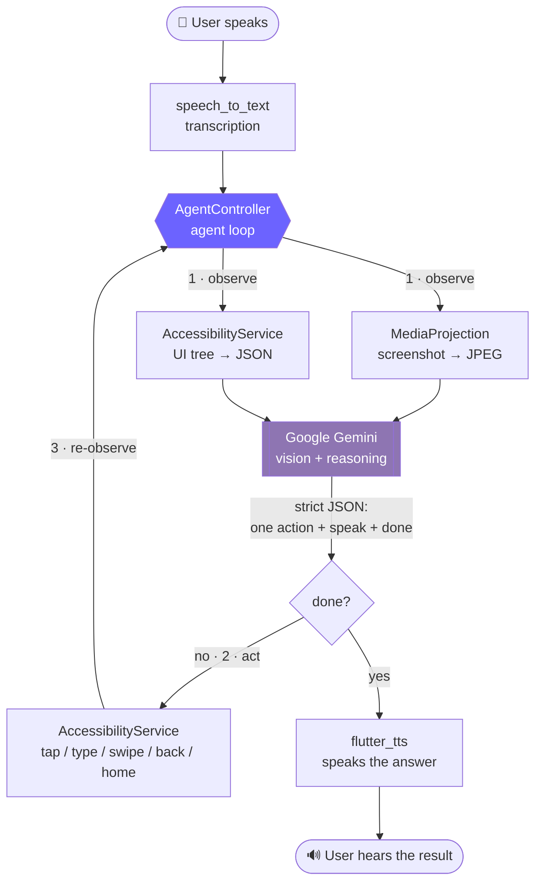

<div align="center">

# 🔮 Lucy

### Your screen-aware AI companion for Android

**Lucy sees your screen, understands what's on it, and taps, types and swipes for you — all from a voice command.**

[](https://github.com/alzin/lucy-screen-agent/releases/latest)
[](https://github.com/alzin/lucy-screen-agent/releases)
[](https://github.com/alzin/lucy-screen-agent/actions/workflows/ci.yml)
[](LICENSE)
[](https://flutter.dev)
[](https://developer.android.com)
[](https://ai.google.dev)
[](CONTRIBUTING.md)
[](https://ko-fi.com/alzin)

<a href="https://github.com/alzin/lucy-screen-agent/releases/latest/download/lucy-latest.apk"></a>

[Download](#-download--install) · [Quick Start](#-quick-start) · [How It Works](#-how-it-works) · [Contributing](CONTRIBUTING.md) · [Troubleshooting](#-troubleshooting)

</div>

---

<div align="center">

### 🎬 Lucy in action

https://github.com/user-attachments/assets/2fd60821-7cae-42f9-aa20-763938b61d23

> *"There's an e-mail called 'my manager' in my e-mail list. I want you to send an
> e-mail with the subject 'Today's agenda' mentioning the team meeting at 10 AM."*

Lucy finds the contact, opens the compose screen, fills in the recipient, subject
and body, and sends it. Every tap and keystroke is hers.

</div>

---

> [!IMPORTANT]
> Lucy is an **experimental research project**. To work, she needs two of the most powerful permissions Android offers: **screen capture** and an **accessibility service** that can tap and type on your behalf. Read [Privacy & Security](#-privacy--security) before you install, and prefer a spare or test device.

---

## 📖 Table of Contents

- [What is Lucy?](#-what-is-lucy)
- [Features](#-features)
- [Download & Install](#-download--install)
- [How It Works](#-how-it-works)
- [Requirements](#-requirements)
- [Quick Start](#-quick-start)
- [Using Lucy](#-using-lucy)
- [Building & Releasing](#-building--releasing)
- [Project Structure](#-project-structure)
- [Troubleshooting](#-troubleshooting)
- [Privacy & Security](#-privacy--security)
- [Roadmap](#-roadmap)
- [Contributing](#-contributing)
- [Support the Project](#-support-the-project)
- [License](#-license)

---

## 🔮 What is Lucy?

Most voice assistants are limited to the apps their vendor integrated with. Lucy takes a different approach: instead of using APIs, **she uses the phone the way you do**.

Say *"Open WhatsApp and send Sarah a message saying I'm running late."* Lucy will:

1. 👂 Transcribe your voice
2. 📸 Take a screenshot of whatever is currently on screen
3. 🌲 Read the Android **accessibility tree** — every button, label and text field with exact pixel bounds
4. 🤖 Send the screenshot **and** the UI tree to Google Gemini, which replies with a single next action
5. ⚡ Execute that action through the accessibility service — a real tap, a real keystroke
6. 🔁 Take a fresh screenshot and repeat until the task is done
7. 🔊 Speak the result back to you, in your language

Because Lucy works at the screen level, she works with **any app on your phone** — no integration required.

### Who Lucy is for

Lucy started with a simple problem: **driving**. On a long drive you constantly want small things from your phone — reply to a message, skip to another playlist, re-route to a petrol station — and every one of them normally means picking the phone up. Lucy lets you ask out loud and keep both hands on the wheel.

That turned out to be one case out of several. The common thread is *your hands are busy, or using them is hard*:

| | |
|---|---|
| 🚗 **Driving** | Reply, navigate and change music by voice, without reaching for the phone. |
| ♿ **Limited dexterity** | Tremor, arthritis, RSI, paralysis, or a temporary cast — Lucy does the tapping. Screen readers describe a screen; Lucy actually operates it. |
| 👩‍🍳 **Hands full or dirty** | Cooking, workshop, gardening, gloves in winter, carrying a child or the shopping. |
| 👴 **Unfamiliar with the phone** | Say what you want instead of hunting through five levels of settings menus. |
| 🔁 **Tedious multi-step chores** | Anything buried eight taps deep across three apps becomes one sentence. |
| 🧩 **Apps with no automation** | No API, no Shortcuts support, no integration? Doesn't matter — Lucy drives the UI itself. |

> [!WARNING]
> Lucy is a hands-free convenience, **not a safety device**. She is experimental and can act on the wrong element. If you use her while driving, set the command running before you move off and keep your eyes on the road — never read or correct her mid-drive. Obey your local road traffic laws; in many countries, including Japan, operating or looking at a phone screen while the vehicle is moving is an offence regardless of how the phone is controlled.

---

## ✨ Features

| | |
|---|---|
| 🗣️ **Voice-driven** | Speech-to-text in, text-to-speech out. No typing required. |
| 👁️ **Screen-aware** | Combines a JPEG screenshot with a structured accessibility tree, so the model sees *and* reads the screen. |
| 🎯 **No hallucinated taps** | The model taps elements **by ID**, never by guessed coordinates. Real pixel bounds are resolved on the Dart side from the accessibility tree. |
| 🌍 **Five languages** | English, Hindi, Kannada, Japanese and Arabic, with matching Android STT/TTS locale requests and language-aware replies. Actual recognition/voice availability depends on installed Android language packs. |
| 🔄 **Agentic loop** | Observe → decide → act → re-observe, up to 50 steps per command. |
| 🛑 **Always interruptible** | A persistent "Stop Lucy" notification cancels the agent instantly, even while she's inside another app. |
| 🎨 **Live transcript** | Every screenshot, action and reply is shown in a scrollable conversation view. |
| 🔑 **Bring your own key** | Your Gemini API key stays on your device. No backend, no telemetry, no account. |

---

## 📥 Download & Install

Every release ships a ready-to-install APK. You don't need Flutter, Android Studio,
or a computer at all — just your phone.

<div align="center">

<a href="https://github.com/alzin/lucy-screen-agent/releases/latest/download/lucy-latest.apk"></a>

</div>

That link never changes and always serves the **newest stable build**. If you want a
smaller download or a specific version, pick one from the
[Releases page](https://github.com/alzin/lucy-screen-agent/releases):

| File | Who it's for |
|---|---|
| `lucy-latest.apk` | The newest stable build, always at the same URL. Installs on any device. |
| `lucy-vX.Y.Z-arm64-v8a.apk` | **Most people** — any Android phone from roughly 2017 onwards. Smallest download. |
| `lucy-vX.Y.Z-universal.apk` | Every CPU variant in one file. Larger, but installs anywhere. |
| `lucy-vX.Y.Z-armeabi-v7a.apk` | Older 32-bit phones. |
| `lucy-vX.Y.Z-x86_64.apk` | Emulators and x86 tablets. |

Each release also attaches `SHA256SUMS.txt` if you'd like to verify what you downloaded.

### Installing the APK

1. Tap the downloaded `.apk` — from your notification shade, or in **Files → Downloads**.
2. Android asks whether to allow installs from your browser or file manager. Allow it (**Settings → Install unknown apps**), then tap **Install**.
3. Play Protect may warn that the developer is unknown. That's expected for any app not distributed through the Play Store — tap **Install anyway** if you're happy to proceed.

### Then three more steps

Installing is only the beginning; Lucy is inert until she has her permissions and a key. The app walks you through each one:

| | | Where |
|---|---|---|
| ♿ | Enable Lucy's **accessibility service** — this is how she taps and types | [Step 8](#-quick-start) |
| 📸 | Grant **screen capture** when the mic button asks | [Step 9](#-quick-start) |
| 🔑 | Paste a free **Gemini API key** from [AI Studio](https://aistudio.google.com/app/apikey) | [Steps 6–7](#-quick-start) |

> [!WARNING]
> Release APKs are currently signed with a **debug key**, so the signature isn't stable between builds. If you already have Lucy installed, **uninstall her before installing a newer version** — otherwise Android refuses the update with `INSTALL_FAILED_UPDATE_INCOMPATIBLE`. See [docs/RELEASING.md](docs/RELEASING.md#signing).

Would rather build it yourself and read the code first? That's the [Quick Start](#-quick-start) below — very reasonable, given what Lucy is allowed to do.

---

## 🧠 How It Works



### The two sources of truth

Vision alone is unreliable for UI automation — models guess coordinates and miss by 40 pixels. Lucy solves this by giving Gemini **both** a picture and a map:

```jsonc
// What Gemini receives alongside the screenshot
{
  "package": "com.whatsapp",
  "elements": [
    { "id": 5, "type": "Button", "text": "Send", "clickable": true,
      "bounds": { "cx": 1012, "cy": 2180, "w": 120, "h": 120 } },
    { "id": 6, "type": "EditText", "desc": "Type a message", "editable": true,
      "bounds": { "cx": 520, "cy": 2180, "w": 860, "h": 120 } }
  ]
}
```

Gemini replies with `{"type": "tap", "element": 5}` — an **ID**, not a coordinate. Lucy looks up the real bounds and dispatches a gesture there. This single design choice is what makes the agent reliable.

### Available actions

| Action | Parameters | Effect |
|---|---|---|
| `open_app` | `package` | Launch an app by package name |
| `tap` | `element` | Tap the accessibility element with that ID |
| `type` | `text` | Type into the focused input field |
| `swipe` | `startX`, `startY`, `endX`, `endY` | Scroll or swipe |
| `back` | — | Press the system back button |
| `home` | — | Press the system home button |
| `wait` | `ms` | Pause before the next observation |

After each action Lucy waits for the screen to actually settle — a package change, a UI-tree change, or a newly focused text field — instead of sleeping a fixed amount of time.

---

## 📋 Requirements

| | Minimum | Notes |
|---|---|---|
| **Flutter** | Dart SDK `^3.11.1` | Verified on Flutter `3.47.1` / Dart `3.13.1` |
| **Android device** | Android 7.0 (API 24) | Targets API 36. **A physical device is strongly recommended** — emulators often lack a usable STT/TTS engine |
| **JDK** | 17 | Bundled with recent Android Studio |
| **Gemini API key** | free tier works | Get one at [aistudio.google.com](https://aistudio.google.com/app/apikey) |

> [!NOTE]
> **Android only.** Screen capture and the action layer are implemented in Kotlin against Android APIs. There is no iOS target — iOS does not permit this kind of system-wide control.

---

## 🚀 Quick Start

### Step 1 — Install Flutter

If you don't have Flutter yet, follow the [official install guide](https://docs.flutter.dev/get-started/install), then verify your setup:

```bash
flutter doctor
```

Make sure the **Android toolchain** row has a green check. Everything else (iOS, web, desktop) is irrelevant for Lucy.

### Step 2 — Clone the repository

```bash
git clone https://github.com/alzin/lucy-screen-agent.git
```

```bash
cd lucy-screen-agent
```

### Step 3 — Install dependencies

```bash
flutter pub get
```

### Step 4 — Connect your Android device

1. On your phone, open **Settings → About phone** and tap **Build number** seven times to unlock Developer options.
2. Go to **Settings → Developer options** and enable **USB debugging**.
3. Plug the phone into your computer and accept the debugging prompt.
4. Confirm your computer can see it:

```bash
flutter devices
```

### Step 5 — Run the app

```bash
flutter run
```

The first build downloads Gradle dependencies and can take several minutes. Later runs are much faster.

### Step 6 — Get a Gemini API key

1. Open [Google AI Studio](https://aistudio.google.com/app/apikey).
2. Sign in and click **Create API key**.
3. Copy the key — it starts with `AIza...`.

### Step 7 — Add your key to Lucy

In the app, tap the 🔑 **key icon** in the top bar, paste your key and hit **Save**. Lucy stores it with Android-backed `flutter_secure_storage`; the key is sent to Google only for Gemini API authentication.

### Step 8 — Enable the accessibility service

Lucy cannot start without this — it's how she taps and types.

1. The app shows an **"Accessibility Required"** screen on first launch. Tap **Open Settings**.
2. Navigate to **Installed apps** (wording varies by manufacturer) **→ Lucy**.
3. Toggle it **on** and accept the system warning.
4. Return to Lucy with the back button — she detects the change automatically.

### Step 9 — Grant screen capture

Tap the 🎤 **microphone button**. Android shows a **"Start recording or casting?"** dialog — tap **Start now**. This grants the `MediaProjection` permission Lucy uses to screenshot.

### Step 10 — Talk to her

Say something like:

> *"Open the calculator and work out 47 times 12."*

Watch the conversation view fill up with screenshots and actions. 🎉

---

## 🎮 Using Lucy

### Example commands

| | Command |
|---|---|
| 📱 | *"Open YouTube and search for lofi hip hop."* |
| ⚙️ | *"Go to settings and turn on Bluetooth."* |
| 👀 | *"What's on my screen right now?"* |
| 💬 | *"Open WhatsApp and message Mom that I'll call tonight."* |
| ⏰ | *"Set an alarm for 7 in the morning."* |

Lucy asks *"Do you need any further help?"* after each completed task. Answer **"no"** (or "stop", "nothing") and she shuts down cleanly.

### Lucy's personality and memory

Lucy keeps a small, structured memory on this device. You can explicitly save a fact, preference, routine, relationship or contact, set the name/nickname Lucy uses, review saved entries, or ask Lucy to forget one or all entries.

Voice commands are supported in English, Japanese, Arabic, Hindi and Kannada. Examples:

- `Remember that I prefer short explanations`
- `Call me Alex` or `My nickname is Alex`
- `What do you remember about me?`
- `Forget my nickname`
- `Forget everything`

Memory is not learned silently from conversations or repeated app behavior. Lucy saves only details you explicitly ask her to remember or approve. Entries are stored locally with a category, timestamps and confidence value; only relevant entries are included in each AI request. Only a small relevance-ranked subset is attached to an AI request when it helps with that request. You can inspect or delete entries in **Lucy tools → Manage saved memory**.

### Proactive suggestions and action approval

Lucy can optionally check local device signals and post a small number of suggestions. Enable this in **Lucy tools → Proactive suggestions**. You can configure quiet hours, a daily limit and a cooldown, and ask **Why did Lucy suggest that?** to see the stored reason, confidence and risk.

The checks are local-only: low battery, a calendar event starting soon, or a recent notification. For a known messaging app Lucy may offer to help draft a reply, but it does not read the notification body in the background, draft or send a message automatically, or call an AI provider from WorkManager. If you choose to ask Lucy to draft a reply, the normal on-demand context and provider privacy rules apply.

Android WorkManager periodic jobs have a 15-minute minimum interval and may run later under Doze or OEM battery restrictions. This is not an exact timer. Lucy's existing foreground services are used only during active, user-started voice or screen-control sessions; there is no always-on polling foreground service.

Every AI action carries `confidence`, `risk` and `reason` metadata. A local policy can raise the model's risk but cannot lower it. Low-risk actions can proceed; medium-risk actions ask for a yes/no answer; high-risk actions require an explicit approval. Password-field typing and text entry in financial apps are treated as high risk, and Lucy does not repeat sensitive text in the approval prompt.

### Switching language 🌍

Tap the 🌐 **language selector** in the top bar to pick **English**, **हिन्दी**, **ಕನ್ನಡ**, **日本語** or **العربية**. This sets the Android speech-recognition locale. On first launch, Lucy speaks a short setup guide in the selected language. If Android reports that a language pack is unavailable, Lucy stops the retry loop and explains that you need to install the language in your device's speech service or choose another language.

Lucy also **detects the language you actually spoke** and replies in it — the AI tags each response with a language code, and the app switches its TTS voice and follow-up prompts to match. Your choice persists across restarts.

### Stopping the agent 🛑

Three ways, in order of urgency:

1. **The red stop button** in the app — tap the mic button while she's running.
2. **The "Stop Lucy" notification** — swipe down from anywhere, even inside another app, and tap **Stop Lucy**. This is the one you want when she's off doing something in a different app.
3. **Force-stop the app** from Android settings — the nuclear option.

Lucy also stops herself automatically after **50 steps** on a single command, so she can never loop forever.

---

## 📦 Building & Releasing

### Published releases are automatic

Nobody builds or uploads an APK by hand. [`.github/workflows/release.yml`](.github/workflows/release.yml) watches `main` and reads the `version:` in [`pubspec.yaml`](pubspec.yaml). When the semantic part — everything before the `+` — has no matching `vX.Y.Z` tag yet, it analyzes, tests, builds and publishes a GitHub Release with every APK attached.

So the version bump is the trigger, not the merge: merges that leave it alone produce no release, and bumping only the build number after the `+` doesn't either. Full details, including how to cut one, live in **[docs/RELEASING.md](docs/RELEASING.md)**.

### Building a release APK locally

```bash
flutter build apk --release
```

The APK lands in `build/app/outputs/flutter-apk/app-release.apk`. Without a keystore this is signed with the debug key — fine for testing on your own device, not for distribution.

<details>
<summary><b>Signing it with your own key</b></summary>

**1. Create a keystore**

```bash
keytool -genkey -v -keystore lucy-release.jks -keyalg RSA -keysize 2048 -validity 10000 -alias lucy
```

**2. Create `android/key.properties`**

```properties
storePassword=<your store password>
keyPassword=<your key password>
keyAlias=lucy
storeFile=<absolute path to lucy-release.jks>
```

Build again and Gradle picks it up automatically.

> [!WARNING]
> `key.properties`, `*.jks` and `*.keystore` are in `.gitignore`. **Never commit them.** Anyone with your keystore can publish updates impersonating your app.

To sign the *published* releases too, the same keystore goes into four repository secrets — see [docs/RELEASING.md](docs/RELEASING.md#signing).

</details>

<details>
<summary><b>Building an App Bundle for the Play Store</b></summary>

```bash
flutter build appbundle --release
```

</details>

---

## 📁 Project Structure

```
lucy-screen-agent/
├── lib/
│   ├── main.dart                          # App entry point, theme, LucyApp widget
│   ├── screens/
│   │   └── home_screen.dart               # Conversation UI, mic button, API-key dialog,
│   │                                      # accessibility gate, language selector
│   └── services/
│       ├── agent_controller.dart          # ⭐ The brain: agent loop, state machine,
│       │                                  #    action execution, language handling
│       ├── ai_service.dart                # Gemini client, system prompt, JSON parsing
│       ├── voice_service.dart             # speech_to_text + flutter_tts wrapper
│       └── screen_capture_service.dart    # Dart side of the platform channel
│
├── android/app/src/main/kotlin/com/poc/screen_aware_ai/
│   ├── MainActivity.kt                    # Method-channel host, MediaProjection consent
│   ├── ScreenCaptureService.kt            # Foreground service: VirtualDisplay → JPEG
│   ├── ScreenActionService.kt             # AccessibilityService: UI tree + gestures
│   └── OverlayService.kt                  # Persistent "Stop Lucy" notification
│
├── test/                                  # Widget tests
├── docs/
│   ├── ARCHITECTURE.md                    # Deep dive for contributors
│   └── RELEASING.md                       # How versions become downloadable APKs
└── .github/workflows/
    ├── ci.yml                             # Format, analyze, test, debug APK
    └── release.yml                        # Publishes a Release when the version bumps
```

**Data flow in one line:** `home_screen.dart` → `agent_controller.dart` → (`ai_service.dart` ⇄ Gemini) → `screen_capture_service.dart` → `MethodChannel` → Kotlin services → Android.

📚 New contributors should read **[docs/ARCHITECTURE.md](docs/ARCHITECTURE.md)** — it explains the agent loop, the platform-channel contract, and how to add a new action.

---

## 🔧 Troubleshooting

<details>
<summary><b>"Accessibility Required" screen won't go away</b></summary>

Some manufacturers (Xiaomi, Oppo, Vivo, Samsung) bury accessibility toggles or silently revoke them.

- Look under **Settings → Accessibility → Installed apps / Downloaded apps → Lucy**.
- On MIUI/ColorOS you may also need to disable battery optimisation for Lucy and enable **Autostart**.
- Fully close and reopen the app after enabling — Lucy re-checks on resume, but a cold start is a reliable reset.

</details>

<details>
<summary><b>"Screen capture permission denied" or blank screenshots</b></summary>

- Tap the mic button again and accept the **"Start now"** dialog.
- On Android 14+, the MediaProjection token is **single-use**. If you switch away for a long time, Lucy re-requests permission automatically — accept it again.
- Some apps set `FLAG_SECURE` (banking apps, Netflix) and their screens come back black. This is enforced by Android and cannot be worked around.

</details>

<details>
<summary><b>Lucy doesn't hear me / listening times out</b></summary>

- Grant the **microphone** permission (Android asks on first use).
- Make sure a speech-recognition engine is installed — usually the *Google* app → **Settings → Voice**.
- Check that the language selected in the top bar matches the language you're speaking; the STT locale is set from it.
- Lucy retries listening 3 times, then stops and asks you to tap the mic again.

</details>

<details>
<summary><b>"⚠️ Please set your Gemini API key first"</b></summary>

Tap the 🔑 icon and paste a valid key from [AI Studio](https://aistudio.google.com/app/apikey). If it still fails, your key may be rate-limited or restricted — check the quota page in AI Studio.

</details>

<details>
<summary><b>Lucy taps the wrong thing</b></summary>

This usually means the accessibility tree is incomplete — some apps (games, or apps with poor semantics) expose very little. Check the conversation view: if the action summary shows a `tap` on an element that doesn't match, the UI tree given to the model was misleading. Please [open an issue](https://github.com/alzin/lucy-screen-agent/issues) with the app name and what you asked for.

</details>

<details>
<summary><b>Gradle build fails on first run</b></summary>

- Confirm JDK 17: `java -version`.
- Wipe and retry: `flutter clean`, then `flutter pub get`, then `flutter run`.
- `android/local.properties` is generated by Flutter and gitignored — if it's missing, running `flutter run` once recreates it.

</details>

---

## 🧠 Lucy personality, memory and setup (Phase 6)

- The agent personality and behavior rules are loaded from `assets/lucy_system_prompt.txt`, so prompt updates no longer require editing provider code.
- User-approved memories remain structured and local, with relevance-based context selection. The settings screen can inspect and delete individual memories or clear all of them.
- The settings screen can inspect stored app layouts and safe learned skills, or reset that learning data. “Delete all my data” also clears the learning store.
- A first-time setup guide explains Accessibility, screen capture, notification access, Usage access and optional Calendar access. Android still presents its own consent/settings screens; Lucy cannot silently grant permissions.

## 🔐 Privacy & Security

Please read this before installing. Lucy is powerful precisely because she has deep access.

**What leaves your device**

- 📸 **Screenshots** (downscaled to max 1280px, JPEG quality 72) and the **accessibility tree** (which can contain visible app text) are sent to whichever AI provider processes the current step.
- Gemini, Groq and Grok can receive screen images. The optional 100milionseek/HMS provider is text-only and is skipped when a screenshot is attached.
- Lucy tries the selected provider first, then Gemini, Groq, Grok and HMS as available. A fallback provider may therefore receive the same current task context if an earlier provider fails.
- 🎤 **Voice** is transcribed by Android's speech-recognition service. Audio handling depends on the recognizer and Android/device settings.
- If enabled, foreground-app name, notification summaries/details, calendar events and approximate location may be included in the AI prompt context. These sources are permission- and setting-dependent.

**What does not**

- Lucy has **no project-operated backend**. There is no project account or analytics service.
- Provider API keys are stored with `flutter_secure_storage` and are sent only to their corresponding provider for authentication.
- Phase 6 structured diagnostics log event names, provider/action labels, timings and error types in debug builds. They do not log prompt text, screenshots, notification bodies, phone numbers or API keys.

**What this means in practice**

> [!CAUTION]
> While a task is running, **anything visible on your screen may be sent to Google** — including messages, emails, banking screens and notifications. The accessibility service can also read text fields and dispatch taps. Don't run Lucy while sensitive information is on screen, and review [Google's Gemini API terms](https://ai.google.dev/gemini-api/terms) to understand how prompt data is handled on your tier.

**Privacy & settings (Phase 6)**

Open the shield icon on Lucy's top bar to control cloud AI requests, provider fallback, voice input/output, screen automation, AI screenshot/UI sharing, direct phone actions, saved memory, scheduled reminders, notification context, calendar context, approximate location and proactive suggestions. Quiet hours are configurable on the same screen. The permissions guide explains each access. **Delete all my data** clears saved memories, local app preferences/history, notification cache, scheduled reminders and provider API keys. Android permissions granted in system settings are not revoked by that button; revoke those separately in Android Settings.

**Android permissions and special access**

- `RECORD_AUDIO`: voice input, only while you start listening.
- `INTERNET`: requests to the AI provider and update checks.
- `ACCESS_NETWORK_STATE`: read the current network connectivity type for local context.
- `FOREGROUND_SERVICE`, `FOREGROUND_SERVICE_MICROPHONE`, `FOREGROUND_SERVICE_MEDIA_PROJECTION`, `FOREGROUND_SERVICE_SPECIAL_USE`: visible microphone, screen-capture and stop-control sessions.
- `POST_NOTIFICATIONS`: stop control and scheduled/proactive reminder notifications on Android 13+.
- `ACCESS_COARSE_LOCATION`: optional approximate location context; disabled until opted in.
- `READ_CALENDAR`: optional upcoming-event context; disabled until opted in.
- `PACKAGE_USAGE_STATS` (special Usage Access): optional foreground-app context.
- `READ_CONTACTS`: requested only for contact lookup.
- `CAMERA`: used for the requested camera/flashlight-related operation, subject to device support.
- `WRITE_SETTINGS` (special access): allows the user to review and change system brightness through Android settings.
- `REQUEST_INSTALL_PACKAGES`: opens Android's installer for an update the user chooses to install.
- `QUERY_ALL_PACKAGES`: used to identify installed apps that Lucy can open by package name.
- `com.android.alarm.permission.SET_ALARM`: allows Android's alarm-clock intent.
- Accessibility service: reads the visible UI tree and performs requested taps, typing, swipes and navigation. Enable it manually in Android Accessibility settings.
- Notification listener: optional access to notification metadata/content for local context. Lucy's in-app switch disables its use and clears the cached notification history; Android's system access can also be revoked manually.
- MediaProjection: Android shows a system consent prompt for each screen-capture session.

**Recommendations**

- ✅ Use a spare device, a test profile, or Android's Work Profile.
- ✅ Stop Lucy (via the notification) before opening anything sensitive.
- ✅ Revoke the accessibility service when you're not actively using the app.
- ❌ Never commit your API key, keystore, or `key.properties`.

Found a security issue? Please read **[SECURITY.md](SECURITY.md)** — don't open a public issue.

---

## 🗺️ Roadmap

Ideas that would make great contributions. Comment on an issue or open one to claim it:

- [x] 🔒 **Confirmation gate** for consequential actions (sending messages, purchases, deletions)
- [ ] 🧩 **Pluggable AI backends** — OpenAI, Anthropic, or a local model behind the `AiService` interface
- [ ] 🚫 **App allowlist/blocklist** so Lucy can never touch chosen apps
- [ ] 💾 **Persistent conversation history** across restarts
- [ ] 🌐 **More languages** (see [CONTRIBUTING.md](CONTRIBUTING.md#-adding-a-language) — it's a ~20-line change)
- [ ] 🧪 **Test coverage** for the `AgentController` state machine
- [ ] 📊 **Token/cost counter** in the UI
- [ ] ♿ **Better UI-tree extraction** for apps with weak accessibility semantics

---

## 🤝 Contributing

**Contributions are very welcome** — this project is early and there's a lot of low-hanging fruit.

👉 Start with **[CONTRIBUTING.md](CONTRIBUTING.md)**. It covers the dev setup, code style, the PR process, and walkthroughs for adding a new agent action or language.

Good first issues are labelled [`good first issue`](https://github.com/alzin/lucy-screen-agent/labels/good%20first%20issue).

By participating you agree to the [Code of Conduct](CODE_OF_CONDUCT.md).

---

## ☕ Support the Project

Lucy is free, open source, and developed in spare time. If she saves you some of yours, you can chip in:

<a href="https://ko-fi.com/alzin"></a>

Support is entirely optional and buys no priority on issues or pull requests — it just keeps the API bills paid and the roadmap moving. Starring the repo and filing good bug reports helps just as much.

---

## 📄 License

Released under the [MIT License](LICENSE).

---

<div align="center">

**Built with Flutter and Google Gemini.**

If Lucy is useful to you, consider leaving a ⭐ — it genuinely helps others find the project.

[Report a bug](https://github.com/alzin/lucy-screen-agent/issues/new?template=bug_report.yml) · [Request a feature](https://github.com/alzin/lucy-screen-agent/issues/new?template=feature_request.yml)

</div>
"# Android-assistant-" 
"# Android-assistant-" 


### Native alarm and timer permission

Lucy declares `com.android.alarm.permission.SET_ALARM` for Android Clock `ACTION_SET_ALARM` and `ACTION_SET_TIMER` intents. This is a normal permission (no runtime prompt). Alarm and timer requests still open the system Clock UI for user review. See the [Android AlarmClock reference](https://developer.android.com/reference/android/provider/AlarmClock) and [common intents guide](https://developer.android.com/guide/components/intents-common#Clock).


---

## 🎙️ Voice experience (Phase 5)

Lucy supports two user-started microphone modes:

- **Continuous conversation:** tap the microphone once. Lucy listens, answers, and resumes listening after each response. The session ends after 60 seconds without detected speech, or when you tap Stop.
- **Push-to-talk:** press and hold the microphone button while speaking. On release, Lucy allows a short recognition-finalization window, completes the captured command, then closes the microphone session. Push-to-talk does not request screen capture permission; use tap-to-start continuous mode for screen-based app automation.
- **Interrupt a spoken response:** tap the microphone while Lucy is speaking. Lucy stops the current response and reopens listening for your next command. This is tap-to-interrupt, not full-duplex voice interruption; Lucy does not run a second microphone recognizer over her own TTS audio.
- **Voice controls:** use the voice-settings icon to choose Calm, Balanced or Bright, then adjust speaking speed, pitch and volume. These values are saved locally.
- **Offline commands:** the current time, battery status and flashlight on/off are handled on-device without an AI request. Flashlight control asks for Android camera permission when needed.
- **Avatar feedback:** Lucy's face and status label react to listening, thinking, speaking, working and confirmation states.

### Microphone privacy

The microphone is started only after you tap or hold Lucy's microphone control. Android shows the ongoing microphone foreground-service notification with a Stop action. Lucy does not implement an always-on wake-word listener in this phase. Speech recognition uses Android's installed recognition service; whether audio is processed on-device or by the device vendor's recognition provider depends on Android and the selected speech service.

### Voice phase validation

1. Tap the microphone and say “What time is it?”; verify the answer works with mobile data and Wi-Fi disabled.
2. Say “Battery status”; verify the percentage and charging state.
3. Say “Turn flashlight on”, then “Turn flashlight off”; deny camera permission once and verify Lucy explains that it could not change the torch.
4. Tap the microphone while Lucy is speaking; verify speech stops and Lucy listens again.
5. Hold the microphone, say a short command, then release; verify listening stops.
6. Leave continuous conversation silent for 60 seconds; verify Lucy closes the session.
7. Change voice style, speed, pitch and volume; restart Lucy and verify the settings persist.
8. Switch through English, Hindi, Kannada, Japanese and Arabic; verify the selected recognition and TTS locales where installed.

**Known voice limitation:** simultaneous voice barge-in while Lucy is speaking is not enabled because the speech recognizer can mistake Lucy's own TTS for the user's command. Tap-to-interrupt is provided; reliable full-duplex barge-in needs device-tested acoustic echo cancellation and voice-activity detection.

No new Android permissions or pubspec dependencies are introduced by Phase 5. The existing `RECORD_AUDIO` permission and microphone foreground service are reused. Phase 5 does not add model actions, so the Phase 4 action/decision JSON schema is unchanged.


---

## 🧰 Reliability and recovery (Phase 6)

- **Plan-first responses:** each model response can include a short ordered `plan` (maximum 8 steps) and no more than one action. Lucy retains the plan across model turns and provider switches.
- **Action verification:** accessibility actions are checked against a fresh UI tree/package snapshot. Native phone actions are checked against their MethodChannel result. Lucy does not report a UI action as complete solely because it was dispatched.
- **Stuck-loop protection:** Lucy detects a repeated action on an unchanged screen and several different attempts against the same unchanged screen. It requests a re-plan, permits at most two re-plans per task, and stops rather than repeating indefinitely.
- **Safe permission recovery:** system permission windows are included in the accessibility snapshot. If Lucy detects a permission prompt, it pauses and asks you to review it manually. Lucy never taps an Allow button automatically.
- **Provider fallback:** Lucy tries the selected provider first, then Gemini, Groq, Grok and finally 100milionseek/HMS. HMS remains text-only and is skipped when a screenshot is attached. Provider attempts and failures are recorded without raw error bodies or credentials.
- **Read-only cache:** a small in-memory cache keeps only successful, action-free text answers for 20 seconds. It excludes screen/image requests, memory-bearing requests, dynamic/time-sensitive questions, and likely personal identifiers. It is cleared when the chat is reset.
- **Structured diagnostics:** debug builds emit timestamped JSON events for provider attempts, latency, action dispatch/verification, re-plans and failures. Prompts, screenshots, message bodies, phone numbers and secrets are not logged.

### Phase 6 action response schema

The model response now includes a plan and at most one action. Every action must contain confidence, risk and reason; Lucy validates these fields and rejects unsupported action types.

```json
{
  "plan": ["Open the requested app", "Find the requested item", "Verify the result"],
  "actions": [
    {
      "type": "open_app",
      "package": "com.whatsapp",
      "confidence": 0.96,
      "risk": "low",
      "reason": "Opening an app is reversible navigation."
    }
  ],
  "speak": "",
  "done": false,
  "lang": "en"
}
```

### Phase 6 device validation

1. Ask Lucy to open an installed app; verify it checks the foreground package before reporting success.
2. Ask Lucy to tap a visible element; verify a fresh UI tree is captured afterward.
3. Use a test screen with a permission prompt; verify Lucy pauses and waits for you instead of tapping Allow.
4. Temporarily disable Accessibility and issue a screen task; verify Lucy reports the blocker and does not guess coordinates.
5. Test with the selected provider unavailable and a second configured provider; verify fallback works. Do not enter real account credentials for this test.
6. Repeat a harmless navigation request on a test app with a deliberately unchanged screen; verify Lucy re-plans and stops after its retry limit.
7. Ask the same non-dynamic, text-only question twice within 20 seconds with screen capture unavailable; verify the second answer can be served from the in-memory cache.
8. Inspect debug logs; verify they contain event metadata only and no prompt text, screenshots, secrets, phone numbers or notification bodies.

No new Android permissions or pubspec dependencies are introduced by Phase 6. The existing accessibility service is reused to observe application and system windows. The only Android source change allows system windows to appear in the UI snapshot so permission prompts can be identified.
